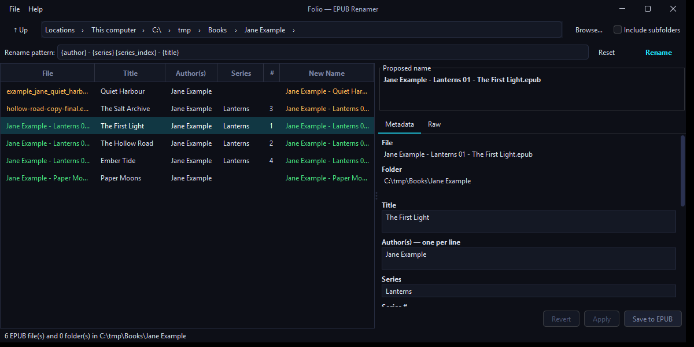

# Folio

[](https://github.com/wasootch/folio/actions/workflows/build.yml)



A small desktop app for browsing a folder of EPUB files, viewing their
metadata, and bulk-renaming them from a template built out of author, series,
and title information.

Built with plain Java (Swing + the JDK's built-in zip/XML support). The two
dependencies are FlatLaf, for the dark neon-accent look (colours live in
`ui/Theme.java`), and JNA, used for the native Windows folder dialog;
`mvn package` bundles both into `target/folio.jar`.

## Requirements

- Java 17 or newer
- Maven

## Build & run

```
mvn package
java -jar target/folio.jar
```

Or run directly during development:

```
mvn exec:java
```

## Using it

1. Navigate to a folder of EPUBs. The app starts at **Locations**, which
   lists:

   - **This computer** — your drives (physical and mapped), then folders;
   - **Network shares** — shares you've opened before (right-click one to
     remove it);
   - **Network** — servers (ones you've used, plus the computers Windows
     itself finds, the same list as Explorer's Network folder), then their
     shares, then folders. The search can take a minute, so it runs once in the
     background: the list fills in as servers turn up, you can navigate away and
     it carries on (returning won't start another), and F5 searches again.

   Ways to move around:

   - **Double-click a folder** in the list (or select it and press Enter).
   - **Click a breadcrumb** in the address bar to jump to that level, or click
     the `›` after one to drop down what's inside it.
   - **Up** (or Alt+Up / Backspace) goes up one level.
   - **Back / forward**: the mouse's back and forward buttons (or Alt+Left /
     Alt+Right) return to the previously viewed location.
   - **Type or paste a path**: click empty space in the address bar (or press
     Ctrl+L / F4), paste e.g. `\\server\share\books` — quotes from Explorer's
     "Copy as path" are fine — and press Enter. A bare `\\server` lists that
     server's shares.
   - **Browse…** opens the native Explorer folder dialog (via JNA) on Windows,
     and `JFileChooser` elsewhere.

   Check **Include subfolders** to include EPUBs from all subfolders in the
   list. Folders are always listed first.

2. The table lists the folders and every EPUB found, with title/author/series parsed from
   each file's OPF metadata (standard Dublin Core fields, plus Calibre-style
   and EPUB3 collection-style series info). Select a single book to see it in
   the side panel, which has:

   - **Proposed name** — the file name the book would be renamed to.
   - **Metadata** tab — the book's fields, all editable; long values wrap.
     Edits change the proposed name immediately and mark the row *(edited)*,
     but nothing is written to the EPUB until you click **Save to EPUB**.
     **Revert** discards a book's unsaved edits. Use this to fill in data the
     file is missing (series, author, etc.) so the rename comes out right.
   - **Raw** tab — the OPF `<metadata>` block exactly as stored in the file,
     including anything Folio doesn't interpret.

   **Editing several books at once:** select two or more books and the same
   Metadata form stays in place; only **Series**, **Author(s)**,
   **Publisher** and **Language** remain enabled (title, series #, date,
   identifier and description belong to one book, so they're greyed out). A
   field shows the common value, or stays blank with a grey hint listing the
   differing values. Type a value and click **Apply to N books**. If the books currently hold *different* values for a field you
   changed, Folio lists them and asks before overwriting; if they're all the
   same or empty it just updates. Applying only edits in memory (rows show
   *(edited)*); **Save N to EPUB** and **Revert** then act on all selected
   books.

   **Ctrl+S** saves the book(s) shown (in multi-edit it applies any typed
   changes first). Saving happens in the background, so you can keep editing
   while it runs; later edits stay marked as unsaved.

   **Save to EPUB** changes only the fields you edited and leaves the rest of
   the OPF alone. Before the first save, the original is kept as
   `<name>.epub.bak` beside it (renamed, not copied, so it's instant) (an existing `.bak` is never overwritten, so it
   always holds the very first original). Folio re-reads the file afterwards to
   confirm what it now contains. Navigating away or closing the window asks
   first if edits are unsaved.
3. Edit the **Rename pattern** field to control the generated filename. The
   **New Name** column updates live. Available tokens:

   | Token             | Meaning                          |
   |-------------------|-----------------------------------|
   | `{title}`         | Book title                       |
   | `{author}`        | First listed author              |
   | `{authors}`       | All authors, comma-separated     |
   | `{series}`        | Series name                      |
   | `{series_index}`  | Position in series (zero-padded) |
   | `{publisher}`     | Publisher                        |
   | `{year}`          | Year, from the publish date      |
   | `{language}`      | Language code                    |

   Default: `{author} - {series} {series_index} - {title}`

4. Click **Rename** to apply the current pattern. With rows selected, only
   those are renamed; with nothing selected, all listed files are renamed.
   A confirmation lists each current name and the new name it will get (and
   notes if any use edits that haven't been saved to the EPUB). Files whose
   name wouldn't change are left out. Renames are skipped (and reported) if a
   file with the target name already
   exists, so nothing is ever silently overwritten.

## Command line

```
java -jar target/folio.jar [--debug] [--path <folder>] [--help]
```

- `--debug` shows the log panel at startup.
- `--path <folder>` starts there, exactly as if you had typed it into the
  address bar, e.g. `--path "\\SERVER_NAME\Books\Some Author"`. Handy while
  developing. A trailing backslash is fine even inside the quotes, though
  Windows itself mangles that form (`\"` becomes a literal quote), so Folio
  repairs it. (With Maven: `mvn exec:java -Dexec.args="--debug --path C:\Books"`).

The **File** menu has Exit; **Help** has *Show Log Panel* (toggle) and *About*.

## Logging

Folio logs what it's doing (folder scans, per-file parse failures, rename
actions) to:

- The **Log** panel at the bottom of the window — hidden by default; show it
  with Help → Show Log Panel or `--debug`. It has a **Clear** button and an
  **Open Log File** button, and keeps collecting while hidden.
- A log file at `~/.folio/folio.log`, appended to across runs — useful if the
  app was launched by double-clicking the jar and there's no console to see.
- The console, if launched from a terminal (`java -jar target/folio.jar`).

If a particular EPUB fails to parse, or a folder won't open, check the Log
panel first — it will name the file and the underlying error.

## Project layout

```
src/main/java/ca/scottadams/folio/
  FolioApp.java              application entry point, logging setup
  model/BookMetadata.java    parsed metadata for one EPUB
  epub/                      EPUB (zip/OPF) metadata reading and writing
  rename/                    filename template rendering + sanitizing
  logging/AppLogging.java    java.util.logging configuration (console + file)
  ui/                        Swing main window, table model, log panel
```

## License

Folio is released under the [MIT License](LICENSE). It bundles FlatLaf and JNA, which keep their own
licences; see [THIRD-PARTY-NOTICES.md](THIRD-PARTY-NOTICES.md).
